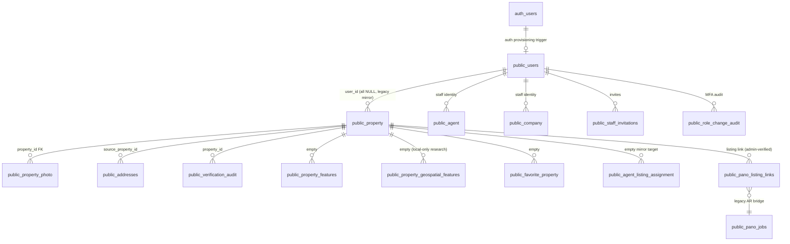

# Current ERD (as audited, 2026-11-22)

## Entity-relationship state — Local PostgreSQL `Final_Location_Analysis`

```mermaid
erDiagram
    public_users ||--o{ fyp_rental_properties : "owner_user_id FK"
    fyp_users ||--o{ fyp_rental_properties : "owner_id (LEGACY FK)"
    fyp_rental_properties ||--o{ fyp_property_photos : "FK cascade"
    fyp_rental_properties ||--o{ fyp_property_features : "FK cascade"
    fyp_rental_properties ||--o{ fyp_property_geospatial_features : "FK"
    fyp_rental_properties ||--o{ fyp_property_enrichment_category : "FK cascade"
    fyp_rental_properties ||--o{ fyp_property_feature_freshness : "FK cascade"
    fyp_rental_properties ||--o{ fyp_property_listing_sources : "FK"
    fyp_rental_properties ||--o{ fyp_property_listing_verification : "FK"
    fyp_property_subject_links }o--|| fyp_rental_properties : "property_id + catalogue_id"
    fyp_property_subject_links }o--|| demand_gen_subjects : "subject_id (research)"

    fyp_users ||--o{ fyp_recommendation_results : "LEGACY empty"
    fyp_rental_properties ||--o{ fyp_recommendation_results : "LEGACY empty"
    fyp_recommendation_results ||--o{ fyp_ai_explanations : "LEGACY empty"
    fyp_users ||--o{ fyp_favourite_properties : "LEGACY empty"
    fyp_users ||--o{ fyp_virtual_tours : "LEGACY empty"

    public_users ||--o{ public_assessment : "user_id (soft, uuid)"
    public_users ||--o{ public_favorite_property : "user_id (soft, uuid)"
    public_users ||--o{ public_recommendation_result : "user_id (soft, uuid)"
    public_users ||--o{ public_entrepreneur_preferences : "user_id (soft, uuid)"
    public_users ||--o{ public_virtual_tour : "implicit"
    public_users ||--o{ public_agent_listing_assignment : "assigned_by_user_id"

    public_assessment }o..o| fyp_rental_properties : "property_id varchar SOFT (numeric or MD-/EP-)"
    public_favorite_property }o..o| fyp_rental_properties : "property_id text SOFT"
    public_recommendation_result }o..o| fyp_rental_properties : "property_id text SOFT"
    public_virtual_tour }o..o| fyp_rental_properties : "property_id int (no FK)"
    public_property_verification }o--|| fyp_rental_properties : "property_id bigint (no FK constraint)"
    public_verification_document }o..o|| public_property_verification : "verification_id (no FK)"
    public_verification_audit }o..o| fyp_rental_properties : "property_id bigint (no FK)"
    public_listing_change_request }o..o| fyp_rental_properties : "listing_id int SOFT"
    public_listing_change_audit }o..o|| public_listing_change_request : "change_request_id (no FK)"
    public_agent_listing_assignment }o..o| fyp_rental_properties : "listing_id bigint SOFT"
    public_property_enquiry }o..o| fyp_rental_properties : "property_ref (SOFT)"

    fyp_capture_sessions ||--o{ fyp_capture_frames : "FK"
    fyp_capture_sessions ||--o{ fyp_panorama_jobs : "FK"
    fyp_capture_sessions ||--o{ fyp_panoramas : "FK"
```

Key defects of the current state:

1. **Duplicate entity copies in one database** — `fyp.*` legacy clones
   (`users`, `favourite_properties`, `recommendation_results`,
   `ai_explanations`, `virtual_tours`, `activity_log`, `ml_models`) carry real
   FKs but 0 rows; the live SQLModel tables sit in `public.*`. The entity
   schema is split by historical accident, not by design.
2. **Missing referential enforcement** — verification, listing-change,
   enquiry and assignment workflows reference listings through soft columns
   with no FK (deliberate for catalogue refs, but the numeric-only columns
   could safely be enforced).
3. **Identity split** — `public.users` is canonical, but `fyp.users` still
   exists with a pre-auth demo row and a legacy `owner_id` FK from the master.
4. **Mirror infrastructure half-installed** — `sitewise_sync` outbox SQL
   staged but unapplied; `assignment_sync_worker` running code targets
   `public.agent_listing_assignment` (to be repointed at `fyp`).

## Supabase side



`public.property` (30 cols, different names) duplicates
`fyp.rental_properties`; the local→Supabase writer is an out-of-repo process.
`public.verification_audit` carries 916 catalogue-import rows that have no
local counterpart (different lifecycle, documented).
