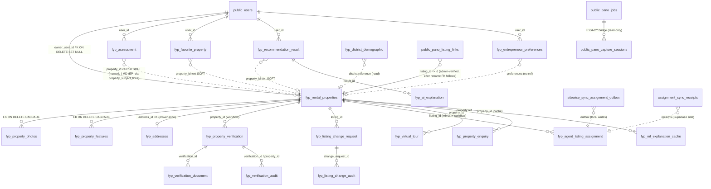

# Target ERD (post-standardization)

One contract, two databases. `fyp` = all business entities (identical both
sides), `public` = identity/security, `sitewise_sync` = outbox, `public.pano_*`
= read-only legacy bridge.

Notes:

- `fyp_rental_properties` = 60-column contract (local 53 + 7 provenance).
  On Supabase the same table results from rename-in-place of `public.property`
  — no second writable copy exists anywhere.
- `fyp.capture_sessions/frames`, `fyp.panorama_jobs/panoramas` remain
  local-operational (documented intentional difference) and join the canonical
  contract at cutover via alembic.
- Research schemas (`fnb_a`, `demand_gen`, `fyp_features`, `popfeat`, geo
  staging) remain local-only and appear nowhere in the operational ERD except
  `demand_gen.subjects` referenced by `fyp.property_subject_links`
  (research linkage, local-only).
- All entrepreneur-facing relationships stay **soft** on `property_id`
  (varchar/text) to support both numeric ids and MD-/EP- catalogue refs;
  user identity relationships are hard FKs to `public.users`.
