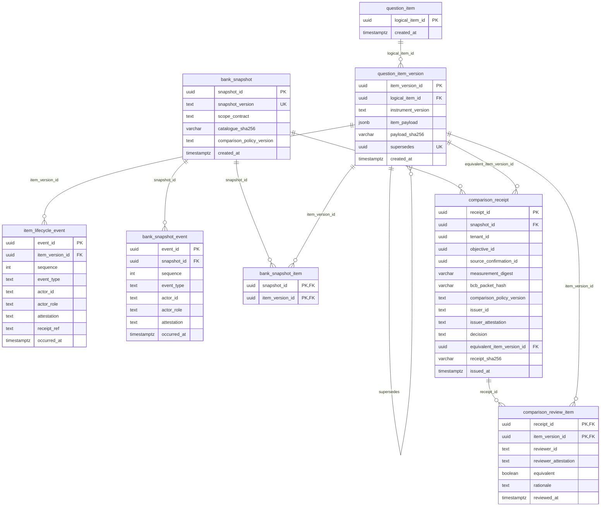

# BD-01 — Corrected Question-Bank Authority Schema

Status: candidate schema, verified in the disposable clone `project1_workflow_tests`.
Not applied to `Dss`. Not applied to `Final_Location_Analysis`.

Forward migration: `backend/migrations/m2/20261118_01_question_bank.sql`
Rollback: `backend/migrations/m2/20261118_01_question_bank_rollback.sql`
Evidence: `backend/var/qgb_evidence/bd01_qgb_evidence.json`

## 1. What was wrong with the candidate

The candidate at `BD01_OPTION_B_CANDIDATE_NOT_APPLIED.sql` carried two defects.

| Defect | Description | Consequence |
| --- | --- | --- |
| BD01-SQL-01 | `question_item_version` and `bank_snapshot` stored the lifecycle in a mutable column (`approval_state`, `state`) constrained by a CHECK, while an append-only trigger rejected every UPDATE. | The CHECK required a transition that the trigger forbade. A version could never leave `CANDIDATE`; a snapshot could never become `ACCEPTED`; no receipt could ever be issued. The schema could not reach an authorising state. |
| BD01-SQL-02 | No table carried a tenant or owner key. | Row-level isolation could not be expressed from the table at all, so any tenant could read any receipt. |

## 2. The correction

The lifecycle is removed from the record and recorded as an event.

* A **version record** is written once and never rewritten. A correction is a new
  version linked by `supersedes`.
* A **lifecycle event** is appended for every transition. Events are themselves
  append-only.
* The **current state is derived** by folding the event log in a view. No row
  ever changes state; the state is a function of history.
* Append-only protection is never disabled, globally or per table.

This keeps the audit property the candidate wanted (nothing is rewritten) while
restoring the property it accidentally removed (a record can progress).

## 3. ERD



`question_item_version` and `bank_snapshot` have **no** lifecycle column. This is
asserted structurally in the evidence file (`structural_assertions`).

## 4. Lifecycle state machines

### 4.1 Item version — `question_item_version_state`

```text
        (no events)  ->  NULL            never implicitly approved
             |
             v   CANDIDATE event
         CANDIDATE
             |
             v   INDEPENDENTLY_REVIEWED event by SCIENTIFIC_REVIEWER
    INDEPENDENTLY_REVIEWED
             |
             v   APPROVED event by OWNER_APPROVER with a DIFFERENT actor_id
         APPROVED
             |
             v   RETIRED event (from any state)
          RETIRED

  Any state --RETIRED event--> RETIRED   (takes precedence over everything)
```

Folding rules, in evaluation order:

| Order | Condition | Derived `approval_state` |
| --- | --- | --- |
| 1 | any `RETIRED` event | `RETIRED` |
| 2 | `INDEPENDENTLY_REVIEWED` by `SCIENTIFIC_REVIEWER` **and** `APPROVED` by `OWNER_APPROVER` with `actor_id` different from that reviewer | `APPROVED` |
| 3 | `INDEPENDENTLY_REVIEWED` by `SCIENTIFIC_REVIEWER` | `INDEPENDENTLY_REVIEWED` |
| 4 | any `CANDIDATE` event | `CANDIDATE` |
| 5 | no events | `NULL` |

`approved_at` is exposed only when the derived state is `APPROVED`.
`scientific_reviewer_id` and `owner_approver_id` are the actors of the earliest
such events. **`approval_state` is the sole authority**; the two actor columns are
audit context and a non-null `owner_approver_id` on a non-`APPROVED` row records
an attempted approval that did not satisfy the two-role rule, not an approval.

### 4.2 Snapshot — `bank_snapshot_state`

```text
   (no events) -> NULL
        |
        v  DRAFT event
      DRAFT
        |
        v  ACCEPTED event with non-empty attestation and a named actor
    ACCEPTED
        |
        v  RETIRED event
     RETIRED
```

`ACCEPTED` is the state the candidate schema could not reach. It is reachable
here because acceptance is a new event row, not an UPDATE of the snapshot.

## 5. Roles and privileges

Roles are created only when absent (`pg_roles` is checked first). They are
cluster-wide `NOLOGIN` group roles; work is performed by `SET ROLE` from a
governed session. The rollback does **not** drop them, because dropping a
cluster role reaches beyond this database.

| Object | `p1_qgb_issuer` | `p1_qgb_runtime` | `p1_qgb_admin` | `PUBLIC` |
| --- | --- | --- | --- | --- |
| `question_item` | SELECT, INSERT | — | SELECT | — |
| `question_item_version` | SELECT, INSERT | — | SELECT | — |
| `item_lifecycle_event` | SELECT, INSERT | — | SELECT | — |
| `bank_snapshot` | SELECT, INSERT | — | SELECT | — |
| `bank_snapshot_event` | SELECT, INSERT | — | SELECT | — |
| `bank_snapshot_item` | SELECT, INSERT | — | SELECT | — |
| `comparison_receipt` | SELECT, INSERT | SELECT (RLS-scoped) | SELECT | — |
| `comparison_review_item` | SELECT, INSERT | SELECT (RLS-scoped) | SELECT | — |
| `question_item_version_state` (view) | SELECT | — | SELECT | — |
| `bank_snapshot_state` (view) | SELECT | — | SELECT | — |
| `approved_question_item_version` (view) | — | SELECT | SELECT | — |
| `accepted_bank_snapshot` (view) | — | SELECT | SELECT | — |
| `accepted_bank_snapshot_item` (view) | — | SELECT | SELECT | — |
| schema `project1_qgb` | USAGE | USAGE | USAGE | — |

Notes:

* No role has UPDATE or DELETE on any object. The append-only triggers would
  refuse it anyway; the grant simply never exists.
* `p1_qgb_runtime` has **no** privilege on any base definition table. Approved
  definitions are reachable only through the three read views.
* `p1_qgb_runtime` is not superuser and does not have `BYPASSRLS`; this is
  asserted in check 8.
* `p1_qgb_admin` bypasses RLS through a permissive `USING (true)` policy, not
  through the cluster-level `BYPASSRLS` attribute. That keeps the bypass
  auditable in `pg_policies` and avoids a cluster-wide security attribute.

## 6. RLS policies

| Table | Policy | Command | Role | Predicate |
| --- | --- | --- | --- | --- |
| `comparison_receipt` | `tenant_select` | SELECT | `p1_qgb_runtime` | `tenant_id = current_setting('project1.tenant_id', true)::uuid` |
| `comparison_receipt` | `issuer_insert` | INSERT | `p1_qgb_issuer` | `WITH CHECK (true)` |
| `comparison_receipt` | `admin_all` | ALL | `p1_qgb_admin` | `USING (true) WITH CHECK (true)` |
| `comparison_review_item` | `tenant_select` | SELECT | `p1_qgb_runtime` | `receipt_id IN (SELECT receipt_id FROM project1_qgb.comparison_receipt)` |
| `comparison_review_item` | `issuer_insert` | INSERT | `p1_qgb_issuer` | `WITH CHECK (true)` |
| `comparison_review_item` | `admin_all` | ALL | `p1_qgb_admin` | `USING (true) WITH CHECK (true)` |

The tenant predicate is the enforcement, not the caller's `WHERE` clause:

* `current_setting('project1.tenant_id', true)` returns `NULL` when the setting
  is absent, so the predicate is `NULL` and no row is visible. Default is deny.
* `comparison_review_item` has no tenant column and is scoped transitively. RLS
  is applied to `comparison_receipt` inside the policy expression, so the
  subquery itself is tenant-filtered.
* A caller cannot widen the result by naming another tenant: the policy is
  evaluated against the row, so `WHERE tenant_id = '<other>'` still yields zero
  rows (check 9).

## 7. Append-only enforcement

One function, `project1_qgb.refuse_rewrite()`, raises
`SQLSTATE 'QGB01'` with message `QGB_APPEND_ONLY: <op> on <table> is not permitted`.
It is attached `BEFORE UPDATE OR DELETE FOR EACH ROW` to:

`question_item_version`, `item_lifecycle_event`, `bank_snapshot`,
`bank_snapshot_event`, `bank_snapshot_item`, `comparison_receipt`,
`comparison_review_item`.

There is no per-table disable flag and no session setting that turns it off.

## 8. Migration guard

Both the forward migration and the rollback require:

```sql
current_setting('project1.qgb_migration_target', true) = current_database()
current_setting('project1.qgb_migration_receipt', true) IS NOT NULL/empty
```

In addition, both hard-refuse `current_database()` in
`('Dss', 'Final_Location_Analysis')` by name, so a caller who sets the guard
setting to a protected database is still stopped.

## 9. Verification summary

All nine checks pass in `project1_workflow_tests`; see
`backend/var/qgb_evidence/bd01_qgb_evidence.json` for the SQL and observed
values. The key results:

| # | Check | Result |
| --- | --- | --- |
| 1 | Clone identity before DDL | `project1_workflow_tests` |
| 2 | Apply / rollback / rollback again / re-apply | all succeed; mismatched guard target refused (P0001) |
| 3 | `CANDIDATE` → `INDEPENDENTLY_REVIEWED` → `APPROVED` | states correct, `approved_at` set |
| 4 | Owner-only and self-approval rejected | `CANDIDATE` and `INDEPENDENTLY_REVIEWED` |
| 5 | Snapshot reaches `ACCEPTED` | `DRAFT` → `ACCEPTED`, `accepted_at` set |
| 6 | UPDATE/DELETE on version and event rows | SQLSTATE `QGB01` on all five probes |
| 7 | Retirement without rewriting history | `RETIRED`; prior `APPROVED` row byte-identical |
| 8 | Tenant isolation, role attributes | tenant B invisible; `rolsuper=false`, `rolbypassrls=false` |
| 9 | Cross-tenant lookup by query alone | zero rows by tenant id and by receipt id |

## 10. Residual gaps (not enforced by this schema)

These are stated so the record does not overclaim:

1. **Receipt against an ACCEPTED snapshot is not enforced.** `comparison_receipt`
   references `bank_snapshot` by id but nothing prevents an issuer from issuing a
   receipt against a snapshot that has no `ACCEPTED` event. A CHECK cannot read
   another table and a trigger was out of the agreed scope. This remains a
   governed-issuer responsibility until a deferred constraint or issuer-side
   transaction check is added.
2. **Snapshot completeness is not enforced.** `bank_snapshot_item` records
   membership but does not prove that the membership covers `scope_contract`.
3. **`equivalent_item_version_id` is not required to be a member of the
   receipt's snapshot.** It is a valid item version, not necessarily one in
   `bank_snapshot_item` for that snapshot.
4. **Event ordering is per-row sequence only.** `UNIQUE (item_version_id, sequence)`
   prevents duplicate sequence numbers but does not require contiguous sequences.
   State derivation does not depend on sequence, only on event type and actor.
5. **`p1_qgb_issuer` INSERT policies are permissive (`WITH CHECK (true)`).** The
   issuer can write any tenant's receipt. Tenant isolation protects readers; it
   does not constrain the issuer. Issuer identity is recorded in `issuer_id` and
   `issuer_attestation` for audit.
