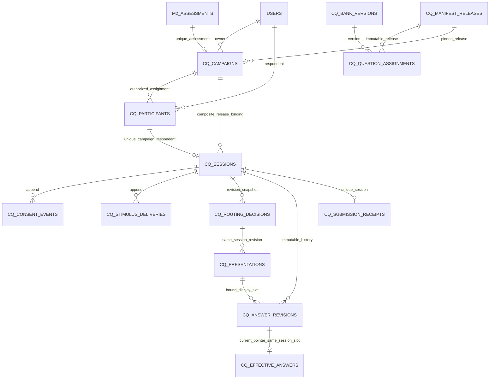

# Proposed CQ schema compatibility and physical ERD

Live Dss was inspected read-only before implementation. Its 28 public tables include nine M2 tables and no CQ tables. No source instrument/items were adopted or seeded. CQ uses the dedicated existing Dss target adapter; the backend-folder default DATABASE_URL names Final_Location_Analysis and is rejected by that adapter. No driver migration, .env change, live migration or record write was performed.

The proposed migration adds 13 tables, two indexes plus constraint indexes, and append-only triggers. It was applied only to new PostgreSQL 18 clusters restored from the read-only PostgreSQL 16.14 Dss schema. Exact physical constraints and private schema dumps are in the evidence. Production-version execution remains a separate gate; PG18 tests do not establish deployment-compatible PG16 acceptance. The migration requires explicit database-target and operator-receipt settings, which are safeguards and do not grant Owner approval.

Physical names are the lowercase forms above. `cq_bank_versions.version` is a global immutable catalogue key; its content hash/questions must match the release. Assignments pin bank/question/content versions. No CQ_FORM_VERSION entity exists. Campaigns have `UNIQUE(assessment_id)`. Sessions have `UNIQUE(campaign_id,respondent_user_id)`, composite campaign/release and participant FKs. Answer display/session/slot and effective event/session/slot FKs prevent cross-session pointers. Root revision CAS and row locks serialize changes. Receipts have one row per session and bind session/receipt/hash in a DB check; application and Dart recompute the canonical hash.

Effective answer rows are mutable pointers, never a second observation. Invalidated answers remain in history and stop contributing to current effective answers. Withdrawal invalidates all current pointers and records an immutable consent event; receipt/history remain retained. Submission receipts are immutable even after withdrawal. Any future downstream reader must honor session WITHDRAWN/consent state and canonical pointers, never count raw history or a retained receipt as another observation.

All CQ tables enable default-deny RLS, revoke PUBLIC privileges, and have no permissive policy. Immutable releases, catalogues, assignments, campaigns, participants, consent, delivery, routing, presentation, answer and receipt rows reject updates/deletes. Only sessions and current pointers are mutable. Private acceptance runs as an explicitly test-only privileged operator. Restricted production service-role grants/policies, separate provisioning/revocation operations, audit retention, backup/migration review and deployment acceptance remain unimplemented production gates. No startup create_all/seed is introduced.

The ERD describes intended cardinalities plus enforced keys. Slot membership and exact version/policy authorization are checked by the application against the immutable catalogue/assignments; SQL alone does not establish scientific approval. Full bootstrap/startup was disabled in tests to avoid unrelated schema creation or seed side effects.
