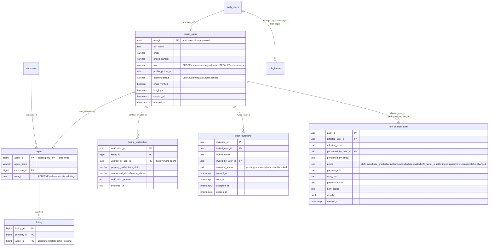

# 11 — Role Model, Staff MFA & Onboarding: Implementation Deliverables

Companion to `10_SYSTEM_AUDIT_2026-11-05.md`. Everything here was implemented
against the EXISTING system — no component was recreated.

---

## 1. Updated logical ERD (auth + staff workflow)



Cross-database note: `sitesense.users` (local) is the FastAPI **enforcement
mirror** keyed by the same Supabase UUID; `Final_Location_Analysis` is
untouched. No ordinary PostgreSQL FK can span databases — the backend
validates cross-database relationships in code.

## 2. Database change summary

| Store | Change |
|---|---|
| Supabase identity | **Additive only** (`backend/supabase/migrations/20261105090000_role_model_staff_mfa.up.sql`): legacy role data mapping (`user`/`property_owner`→`entrepreneur`, `administrator`→`admin`), `role` DEFAULT + CHECK, `account_status` CHECK, RLS on `public.users` (own-row select/update; protected columns guarded by trigger), `staff_invitations` + `role_change_audit` (RLS deny-all to end users; service-role writes), sign-up provisioning trigger, `agent.user_id` (nullable + unique + FK), `updated_at` trigger. Live data observed before migration: 1 row (`role='user'`, `status='active'`). |
| `sitesense` | **No schema change.** The mirror `users` row default is now `entrepreneur` in code; new tables live in Supabase, so `alembic/versions/` stays empty by design. |
| `Final_Location_Analysis` | **None.** |

Rollback: `...mfa.down.sql` (schema) + backup restore (data mapping).

## 3. Implemented (code complete + tests passing)

| Area | Files | Status |
|---|---|---|
| 3-role RBAC with legacy aliases | `backend/src/sitewise/domain/rbac.py` | `test_rbac_domain.py` (10 tests) |
| `aal2` staff enforcement (server-verified `aal` claim, structured `staff_mfa_required` 403) | `dependencies.py` | `test_staff_authorization.py` |
| Agent provisioning via native Supabase invite (no password ever seen by admin; no custom tokens) | `core/supabase_admin.py`, `api/v1/staff.py` | `test_staff_admin_api.py` |
| Invitations + role-change audit (server-generated) | same | same |
| Suspension / reactivation / MFA-factor recovery (documented GoTrue admin endpoint; supabase-py 2.34.0 has no wrapper) | same | same |
| Assigned-listings authorization chain `UUID → agent.user_id → listing.agent_id` + verification scoping | same | `test_staff_authorization.py` |
| Admin role/status changes audited + authoritative identity-row sync | `api/v1/users.py` | `test_staff_admin_api.py` |
| Frontend: AAL-based sign-in, TOTP enrollment screen, password recovery + reset, FastAPI `/api/v1/auth/me` wiring, no client role hints | `fyp_jaspr_web/tool/auth_client.js`, `lib/data/auth_browser.dart`, `pages/staff_mfa_page.dart`, `pages/reset_password_page.dart`, `pages/forgot_password_page.dart`, `app.dart` | Playwright `tool/probe_auth_flows.js` PASS (13 checks), `probe_staff.js` PASS, `dart analyze lib` clean |

Backend test suite: **87 passed** (`python -m pytest` in `backend/`), Supabase
fully faked per the established hermetic strategy.

## 4. Requires configuration / credentials to run for real

1. **Supabase migration execution** (SQL editor / CLI) — script ready, NOT yet
   executed against the live project (per the staging-first rule). Live data
   was only inspected read-only.
2. **Supabase Auth → Redirect URLs**: allow-list the invite/reset redirect
   (`http://localhost:8090/auth/callback`, plus the deployed origin).
3. **Google OAuth** — already configured on the project; untouched.
4. **Email delivery** — Supabase's built-in emails (invite/recovery); rate
   limits apply on the free tier.
5. `backend/.env` — `SUPABASE_SECRET_KEY` already present (verified live for
   read-only inspection); `SUPABASE_STAFF_INVITE_REDIRECT_URL` optional.

## 5. Not implemented / remaining limitations

1. **Admin dashboard UI for staff management** — the `/api/v1/staff/*`
   endpoints exist; the Jaspr admin/agents page still needs wiring to them
   (currently a static workspace page).
2. **Community questionnaire campaigns** — out of scope of this change; no
   backend exists yet (spec section on surveys is design-level only).
3. **MFA recovery self-service via support identity proofing** — implemented
   as admin-supervised factor deletion + audit (Supabase's documented
   method); there is no end-user self-recovery.
4. **Token revocation on suspension** — a suspended account is denied by the
   backend on every request; existing access tokens are not force-invalidated
   (GoTrue admin sign-out per session is not wired).
5. **Flutter mobile app** — still the local demo auth; no Supabase client.
6. **Alembic baseline** — `alembic/versions/` intentionally remains empty
   (no app-DB schema change was required).
7. **Invite acceptance bookkeeping** — `staff_invitations.accepted_at` is
   updated on first successful staff sign-in only when the admin UI calls the
   endpoints (automatic webhook not implemented).

## 6. Environment variables (names only — values stay in `backend/.env`)

| Variable | Purpose |
|---|---|
| `DATABASE_URL` | `sitesense` app DB (mirror + domain data). |
| `ANALYTICS_DATABASE_URL` | `Final_Location_Analysis` (read-only). |
| `SUPABASE_URL`, `SUPABASE_PUBLISHABLE_KEY`, `SUPABASE_JWKS_URL`, `SUPABASE_JWT_AUDIENCES`, `SUPABASE_JWT_LEEWAY`, `SUPABASE_JWKS_CACHE_SECONDS` | Token verification (existing). |
| `SUPABASE_SECRET_KEY` | **Server-only.** Enables the admin adapter (provisioning, audit, invitations, MFA recovery). |
| `SUPABASE_STAFF_INVITE_REDIRECT_URL` | Invite/reset redirect target (must also be allow-listed in Supabase). |
| `SUPABASE_ADMIN_TIMEOUT_SECONDS` | GoTrue admin REST timeout (factor endpoints). |
| `CORS_ORIGINS`, `LOG_LEVEL`, `SECRET_KEY` | Existing app settings. |

## 7. Spec scenario → test mapping (30 required cases)

| # | Scenario | Covered by |
|---|---|---|
| 1-2 | Entrepreneur registers / signs in | Supabase SDK flows (frontend); backend provisions on `/auth/me` — `test_auth_api.py::test_auth_me_provisions_profile_once` |
| 3 | Google sign-in | Frontend `signInWithOAuth` + callback `complete()` (requires live Google provider) |
| 4 | Entrepreneur cannot self-grant staff roles | `test_auth_api.py::test_patch_own_profile_rejects_role_change` + SQL trigger + RLS |
| 5-7 | Admin creates agent; email; password set | `test_staff_admin_api.py::test_admin_creates_agent_and_supabase_invites` (invite via native GoTrue; link setup is live-config) |
| 8-11 | First sign-in, TOTP enroll, verify, dashboard | `tool/probe_auth_flows.js` (screens render) + supabase-js `mfa.enroll/challenge/verify` (live MFA needs an authenticator app) |
| 12-14 | Existing agent sign-in + MFA + assigned listings | `test_staff_authorization.py::test_agent_sees_only_assigned_listings`, `test_agent_with_aal2_gets_valid_empty_state` |
| 15 | Agent without MFA denied | `test_agent_without_aal2_is_denied_with_structured_signal` |
| 16 | Suspended agent denied | `test_suspended_agent_denied` |
| 17 | Nonexistent agent cannot sign in | `test_nonexistent_agent_cannot_sign_in_to_staff` + JWT verification suite |
| 18 | Entrepreneur denied staff endpoints | `test_entrepreneur_cannot_access_staff_endpoints` |
| 19-20 | Admin sign-in + MFA | same aal2 machinery as agent (`test_staff_admin_api.py::test_create_agent_requires_aal2`) |
| 21 | Admin creates agents | `test_admin_creates_agent_and_supabase_invites` |
| 22 | Admin assigns listings | `test_admin_assigns_listing_and_records_audit` |
| 23 | Suspend / reactivate | `test_agent_status_lifecycle_is_audited` |
| 24 | Role changes audited | `test_role_change_via_users_endpoint_is_audited`, `test_agent_status_lifecycle_is_audited` |
| 25 | Agent denied admin endpoints | `test_create_agent_requires_admin` |
| 26 | Profile columns preserved | Migration preserves all 11 columns; `test_auth_api.py` payload shape |
| 27 | Property/listing data unchanged | Migration additive-only; `probe_auth_flows.js` regression checks |
| 28 | No auth secrets in app tables | By construction: no password/MFA columns anywhere (`db/models/user.py`) |
| 29 | Analytics intact | `Final_Location_Analysis` untouched; read-only session unchanged |
| 30 | Supabase users stay linked | UUID-PK identity mapping unchanged (`user_repository.get_or_create_from_supabase`) |

## 8. Migration / rollback quick reference

```bash
# 0. Backup (pick one)
#    Dashboard -> Database -> Backups
psql "$SUPABASE_DB_URL" -c "CREATE TABLE public.users_backup_20261105 AS SELECT * FROM public.users;"

# 1. Apply (Supabase SQL editor or CLI) — single transaction, idempotent
psql "$SUPABASE_DB_URL" -f backend/supabase/migrations/20261105090000_role_model_staff_mfa.up.sql

# 2. Verify (§10 of the .up.sql) — roles canonical, RLS on, triggers armed

# Rollback (schema; data via backup restore)
psql "$SUPABASE_DB_URL" -f backend/supabase/migrations/20261105090000_role_model_staff_mfa.down.sql
```

Backend tests: `cd backend && python -m pytest -q` → 87 passed.
Frontend probes: `node tool/serve_spa.js 8141` + `NODE_PATH=<managed node
workspace>/node_modules node tool/probe_auth_flows.js`.
