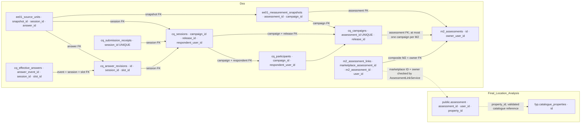

# Assessment → customer questionnaire: current relationships

Verified 2026-11-18 using read-only PostgreSQL transactions. Branch `merge_main_jed`,
HEAD `ba30035ecb24b80fa155cc7049cf3cdf94a67844`; pre-existing dirty edits preserved.

**The schema supports the path, but the saved property assessments are not
connected to the previously completed synthetic questionnaire.**

## Database responsibilities

| Records | Actual configured database / table | Application role |
|---|---|---|
| Property assessments | `Final_Location_Analysis.public.assessment` | `postgres` (`DATABASE_URL`) |
| Catalogue | `Final_Location_Analysis.fyp.catalogue_properties` view | `postgres` (`ANALYTICS_DATABASE_URL`) |
| Marketplace → M2 binding | `Dss.public.m2_assessment_links` | `p1_m2_runtime` |
| M2 and confirmation | `Dss.public.m2_assessments`, `m2_answer_revisions`, `m2_confirmation_snapshots` | `p1_m2_runtime` |
| Campaigns, participants, sessions, answers and receipts | `Dss.public.cq_*` | Dedicated M2 engine; ordinary fielding held |
| EE-01 snapshots / source units | `Dss.public.ee01_measurement_snapshots`, `ee01_source_units` | `p1_ee01_runtime` |

Host `localhost:5432`, driver `postgresql+psycopg2`. The audit uses the existing
local diagnostic operator with enforced read-only transactions to see all RLS
owners. That is separate from M2's restricted application principal.
`Dss.public.assessment` exists but has **zero rows** and is not the configured
marketplace store. Moving records there would change existing responsibilities.

## Actual property-to-M2 bindings

Both sides belong to `32ef694a-69b0-4863-a77f-b9cf6c056b56`.

| Property | Marketplace assessment | Dss M2 assessment | M2 revision / answer revisions | Confirmation snapshots / campaigns |
|---|---|---|---|---|
| `MD-02521` — Fiesta @Axis Pandan | `0a79fba2-3a39-4bd1-96b0-f245a1b2c0a7` | `b438c959-dbb4-4f99-8322-0f841dbba755` | 14 / 14 | 0 / 0 |
| `MD-01965` — GM Klang, Block B | `ffa8c0a3-fcd9-4e12-afa1-b7ce6392cc1b` | `7a2f0b5c-6e75-4aa0-934b-a529681b20ac` | 21 / 21 | 0 / 0 |

Historical answer-revision counts do not mean every required question is currently
answered. Both `confirmed_revision` values are NULL. The two IDs are distinct
namespaces even though both are UUIDs.

## Completed phone test: separate synthetic lineage

| Record | Actual ID / value |
|---|---|
| Case | `06-single-continue-check` |
| M2 assessment | `6a59045c-7bc2-4c1c-942a-f4e97e65166d` |
| Synthetic owner | `e49b0084-b6eb-4865-b4a9-02082eb7655f` |
| Campaign | `43d3898b-7080-4fc2-9fe4-2a18ba6419b0` |
| Session | `78c9374e-776e-523e-ac17-69fc9d6665a5` |
| Receipt | `3827219a-a7c8-4474-8dee-cc5b38a682b3` |
| Submission record / lifecycle | `SUBMITTED` / `COMPLETED`, revision 21 |
| Current answers | 13 questions / 14 cells, including two Q10 cells |
| Origin / mode / reportable | `SYNTHETIC_TEST` / `DEVELOPER_PREVIEW` / false |
| Active property-assessment binding | **None** |

Snapshots `23b3154b-e928-41b2-a5cc-705b600cb018` and
`81b4e15d-db52-4c05-a84f-49772cb2b47c` each include this session through
`ee01_source_units` and have Q/S/A/V = 4/2/2/2. This is persisted synthetic
diagnostic lineage, not research findings or report admission for either property.

Do not reparent the synthetic campaign or answers to a genuine assessment. Those
records describe a fixture context, owner and immutable release.

## Updated relationship diagram

Solid arrows = physical FKs. Dashed arrows = application-validated references.
This diagram describes storage; it does not replace the existing governed workflow.



Active links are unique in both directions through partial indexes
`WHERE revoked_at IS NULL`; revoked rows remain history. The composite link FK
proves the linked user owns the M2. `cq_campaigns.assessment_id` is UNIQUE, preserving
one assessment ≤ one campaign. No CQ_FORM_VERSION is introduced.

## Alerts / remaining gaps

1. **Legacy ERD outdated:** the Nov 17 association report predates the installed
   binding table. Its no-link verdict no longer describes Nov 18. The old CQ ERD
   omits this cross-database boundary. This document supersedes those current-state
   claims, preserving their historical evidence.
2. **Cross-database limitation:** PostgreSQL cannot enforce a native FK from Dss
   to the marketplace database. `AssessmentLinkService.resolve()` verifies
   marketplace ownership first. Creation inserts M2 + link in one Dss transaction,
   never guesses an arbitrary unlinked M2. Two databases are not one transaction.
3. **Missing records, not a missing new table:** neither property-bound M2 has a
   confirmation or campaign. The existing M2 → confirmation → BCB → QJ/bank/
   conditional QG → scientific/owner/fielding requirements still apply. A completed
   synthetic CQ is not a substitute for these records.
4. **Service-enforced consistency:** campaign assessment and owner each have FKs,
   but no composite FK binds that pair to the M2 owner. The existing campaign
   service verifies ownership. EE-01 assessment/campaign/release/owner FKs are also
   separate; its service checks assessment/campaign pairing and owner RLS. There
   are **zero inconsistent stored rows** in the executed integrity checks. Extra
   composite constraints would be schema hardening needing clone tests and separate
   migration authorization; no migration was performed here.
5. **Jaspr Step 5 is a preview:** `CustomerQuestionnaireStep5` receives the marketplace
   ID and uses local preview state. It does not persist a campaign or load the phone
   test's aggregate results. A visible questionnaire preview proves no DB link.
6. **Discard gap:** legacy `AssessmentService.delete_owned` deletes only the
   marketplace row. Its no-children comments predate the cross-database binding;
   the database cannot stop a dangling Dss link. `M2WorkflowPanel` deliberately
   disables its Discard assessment control for this reason. The listing still
   exposes Remove assessment. Safe handling must be reconciled before deleting
   linked records. No existing assessment was deleted during this read-only audit.

## Executed verification and rerun

[VERIFY_MARKETPLACE.sql](VERIFY_MARKETPLACE.sql) runs in Final_Location_Analysis.
[VERIFY_DSS.sql](VERIFY_DSS.sql) runs in Dss. Both explicitly use READ ONLY.

From the repository root:

```powershell
& .\backend\.venv\Scripts\python.exe .\backend\scripts\verify_assessment_cq_relationships.py `
  --output .\artifacts\assessment_cq_relationships_20261118\database_evidence_recheck.json
```

Initial result: `artifacts/assessment_cq_relationships_20261118/database_evidence.json`.
**13 checks PASS; one explicit NOT_CONNECTED finding.** Evidence includes exact
rows, FK/index definitions, SQL hashes, database/role/version and transaction
read-only/isolation settings. Each database uses its own repeatable-read snapshot;
the two snapshots are sequential, not distributed-atomic. This script establishes
no authenticated HTTP/UI result, model execution or scientific approval.
